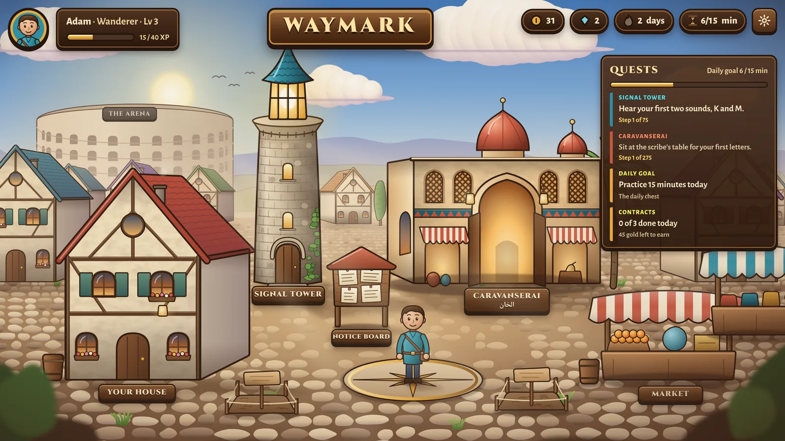
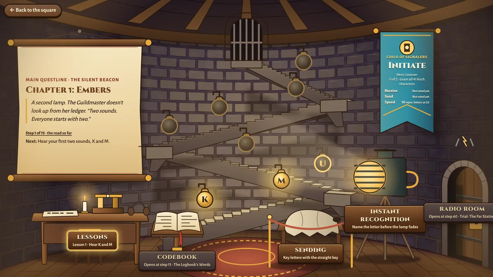
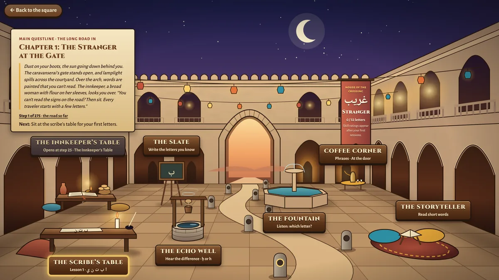
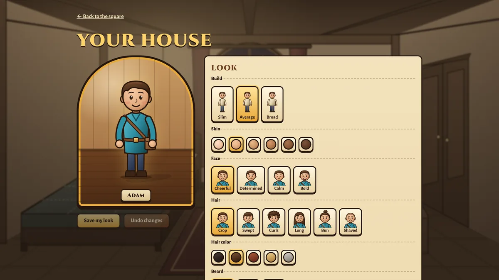
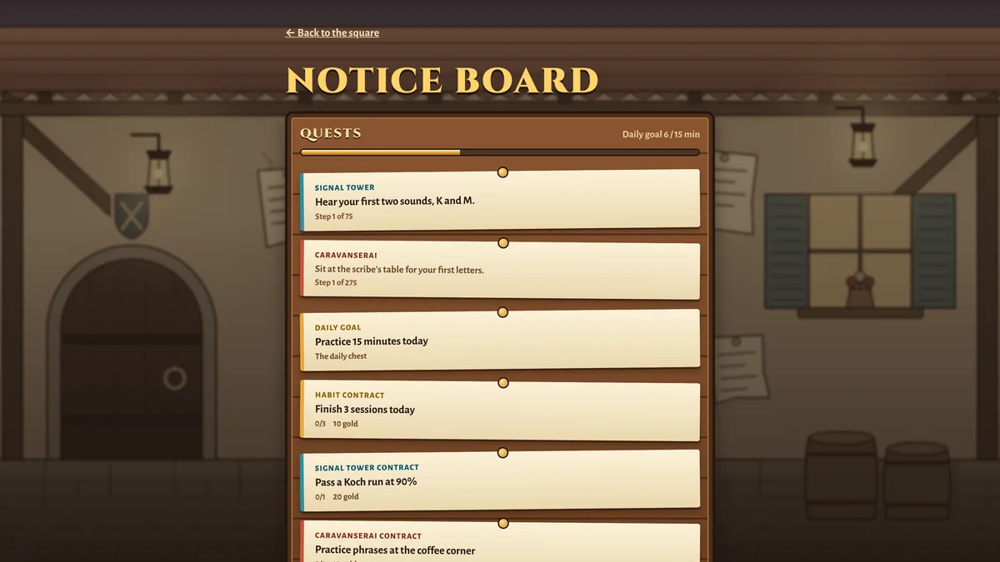
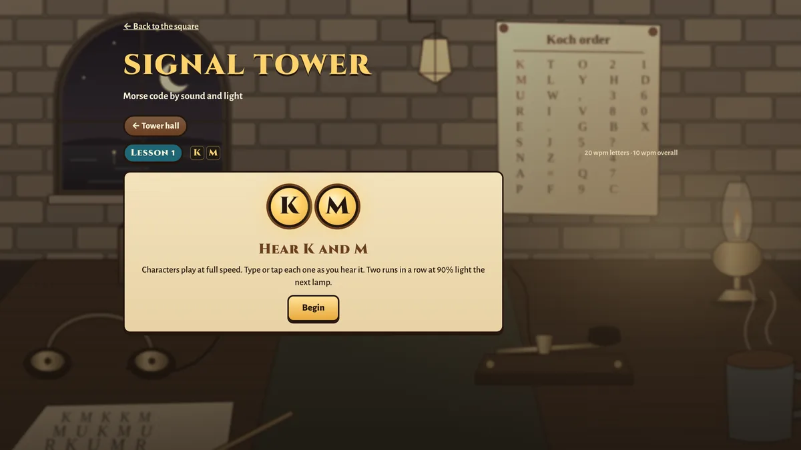
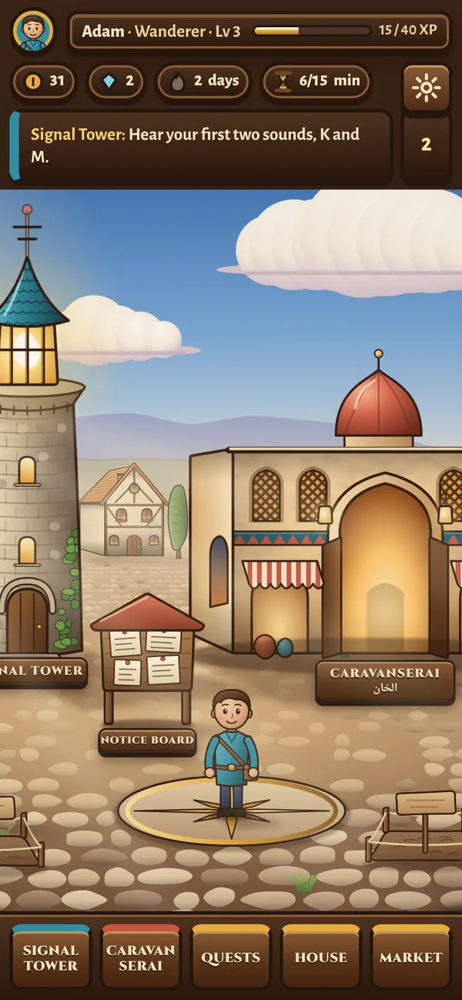
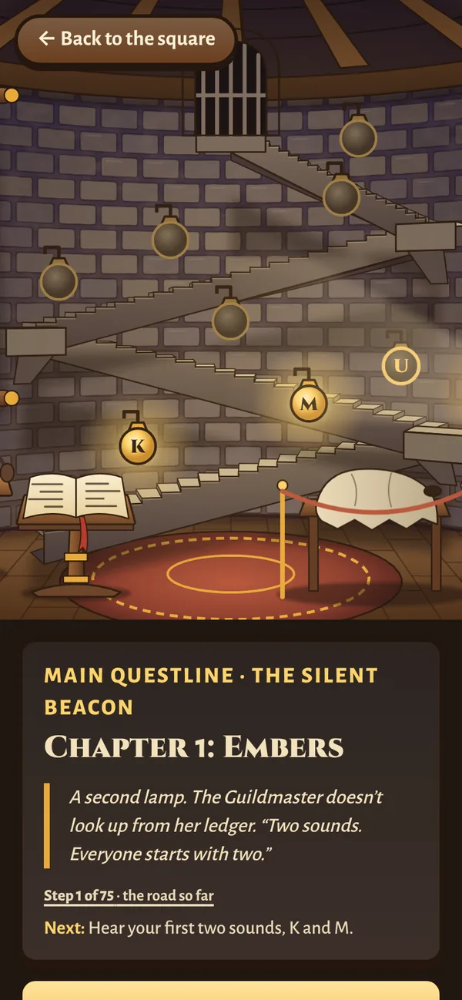

<div align="center">



# Waymark

**Learn Morse code and spoken Palestinian Arabic by walking a painted city.**<br>
One road per subject, and the next step is always on screen.

[Live site](https://waymark-phi.vercel.app) · [What's in 1.0.0](../docs/process/releases/v1.0.0.md) · [Where things stand](../docs/process/STATUS.md)

</div>

---

Waymark is a game for one learner and a few friends. Each subject is a guild hall off the city square, and each hall has a story you walk through one step at a time. Gold, gear and ranks come only from learning, and the database is the only thing that hands them out.

## Two roads

<table>
<tr>
<td width="50%" valign="top">


### The Signal Tower · Morse code

**The Silent Beacon**, in 10 chapters and 75 steps.
- 41 characters by ear at full speed from day one, with the gaps closing as you improve.
- Instant Recognition, sending with your own hand, and whole words and call signs in the Codebook.
- Trials and ranks, and a Radio Room with six operators through noise and fading.
- The finale, **Forty Winters**: a message sent once at 20 words a minute.

</td>
<td width="50%" valign="top">


### The Caravanserai · Palestinian Arabic

**The Long Road In**, in 115 chapters and 275 steps.
- The script from nothing, written on the slate, with Hebrew as the bridge.
- The echo well for sounds Hebrew lacks, plus shadowing and survival phrases with real recordings.
- 3,390 words in sentences, reviewed just before you'd forget them.
- A written chat with the regulars, and the finale, **The Stranger at the Gate**.

</td>
</tr>
</table>

## Around the square

<table>
<tr>
<td width="33%"></td>
<td width="33%"></td>
<td width="33%"></td>
</tr>
<tr>
<td valign="top"><b>Your House.</b> Dress your character in what you've earned, keep a pet, and read the ledger: what you've really learned, in numbers.</td>
<td valign="top"><b>The Notice Board.</b> Today's contracts, your quests and the chests you've won. The Market sells four wares a day for gold.</td>
<td valign="top"><b>A station.</b> Every lesson and drill sits in its own painted room. Sound and motion answer what you do, and each has its own switch.</td>
</tr>
</table>

<table>
<tr>
<td width="30%"></td>
<td width="30%"></td>
<td valign="top">

### On a phone

The same city, sized for a thumb. The top bar always names the next step, and the places sit in a dock.

**With friends:** swap friend codes, visit each other's house, challenge a friend in the Arena, or key Morse to them live on the wire. Friends are invited by hand, and none of this shows until you have one.

</td>
</tr>
</table>

## How it's built

| Part | What it is |
|---|---|
| **App** | React 19, TypeScript and Vite. `src/core/` is the platform and `src/subjects/<id>/` holds one subject each, so a third hall plugs in ([guide](../docs/process/ADDING-A-SUBJECT.md)). |
| **Art** | Every scene is drawn in code as SVG: the city, both halls and a room behind every station. |
| **Backend** | Supabase: Postgres with row-level security, where the database's own functions give out every reward; Realtime for the wire. |
| **Learning** | FSRS spaced repetition (`ts-fsrs`), Koch-method Morse at Farnsworth spacing, and Glicko-style ratings per skill. |
| **Hosting** | Vercel: `main` is the live site, `dev` the dev site. |
| **Tests** | 1,119 unit tests (Vitest), 226 database tests on real migrations (PGlite), and 400+ browser tests at desktop and phone sizes (Playwright). |
| **Decisions** | 49 [decision records](../docs/decisions/), one per choice. |

Content is data, not code. Letters, Morse characters, lessons and the road itself live in [`content/`](../content/). The licensed Arabic word deck stays in `sources/` in this private repo and never enters `content/` or the site's bundle: it's uploaded to the database, readable only behind login by its licensee.

<details>
<summary><b>Run it locally</b></summary>

<br>

Needs Node 22+.

```bash
npm install
npm run dev
```

Then open the address it prints (usually http://localhost:5173). For the login to work, first copy `.env.example` to `.env.local` and fill in the `waymark-dev` Supabase values ([SUPABASE](../docs/process/SUPABASE.md)).

| Script | What it does |
|---|---|
| `npm run dev` | Dev server with hot reload |
| `npm run build` | Type-check, then build the site into `dist/` |
| `npm run preview` | Serve the built `dist/` |
| `npm run lint` | ESLint, plus a Prettier formatting check |
| `npm run format` | Rewrite files with Prettier |
| `npm run typecheck` | TypeScript only |
| `npm test` | Unit tests (Vitest): `*.test.ts(x)` files in `src/`, `tests/` and `supabase/tests/` |
| `npm run test:watch` | The unit tests, rerun on every change |
| `npm run coverage` | The unit tests with a coverage report (to read, not a gate; ADR 0030) |
| `npm run e2e` | Browser tests (Playwright, `e2e/`) at desktop and phone sizes, against a production build with a fake Supabase (`e2e/fake-supabase.ts`) |

`npm run e2e` needs a Chromium for Playwright. On your own machine, run `npx playwright install chromium` once. In the Claude cloud session it's already installed, so don't run that there.

Dependencies are pinned to exact versions (`.npmrc` has `save-exact=true`). `@playwright/test` is pinned to the same version as the Playwright pre-installed in the Claude cloud session (1.63.0), so its Chromium matches. Fonts are self-hosted from npm (`@fontsource/*`), so the site never calls Google Fonts.

</details>

<details>
<summary><b>Where things live</b></summary>

<br>

| Path | What |
|---|---|
| [`src/`](../src/) | The app. `src/core/` is the platform, `src/subjects/<id>/` holds one subject each (ADR 0003, contract in ADR 0019; start a new one from `src/subjects/example/`) |
| [`content/`](../content/) | Learning content as data (letters, words, Morse characters, lessons) |
| [`supabase/`](../supabase/) | Database migrations and their tests |
| [`docs/process/`](../docs/process/) | Current status ([`STATUS.md`](../docs/process/STATUS.md)), the plan ([`PLAN.md`](../docs/process/PLAN.md)) and the version map ([`VERSIONS.md`](../docs/process/VERSIONS.md)), how we work ([`WORKFLOW.md`](../docs/process/WORKFLOW.md)), deploying ([`DEPLOY.md`](../docs/process/DEPLOY.md)), release notes ([`releases/`](../docs/process/releases/)), the history and retros |
| [`docs/vision.md`](../docs/vision.md) | North star: what we are building |
| [`docs/game/`](../docs/game/) | Game rules and numbers: [economy](../docs/game/economy.md), [the Road](../docs/game/the-road.md) (both stories, step by step) and [the tale](../docs/game/the-tale.md) |
| [`docs/decisions/`](../docs/decisions/) | Architecture and product decision records (ADRs) |
| [`docs/design/`](../docs/design/) | Visual concepts and the city generator |
| [`docs/discovery/`](../docs/discovery/), [`docs/research/`](../docs/research/) | Brainstorms, research on methods, apps and sources, and the spikes that answered one question each |
| [`sources/`](../sources/) | Raw learning material. Upload new files to `sources/_inbox/` |
| [`.claude/`](../.claude/CLAUDE.md) | The team charter (roles, conventions), and Claude Code's skills and settings |

</details>

## Credits

Designed and directed by Adam, and built with [Claude Code](https://claude.com/claude-code). The Arabic words come from a Lingualism deck, used under its buyer's license and never served to anyone else. Fonts: Cinzel, Alegreya Sans, Noto Naskh Arabic and Noto Sans Hebrew (SIL Open Font License). Skills in `.claude/skills/` come from [jeffallan/claude-skills](https://github.com/jeffallan/claude-skills) (MIT) and [anthropics/skills](https://github.com/anthropics/skills) (Apache 2.0).
